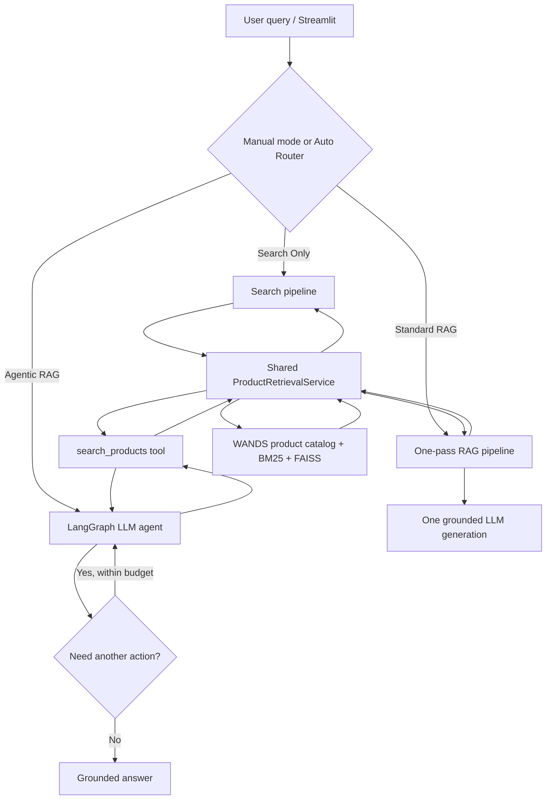

# Design Doc: Adaptive Home Shopping Search — Retrieval, Standard RAG & Agentic RAG

**Version:** v1.5 — WANDS, shared retrieval, task-based routing, coordinated product discovery  
**Updated:** November 3, 2026  
**Status:** Implementation-ready, learning-first design  
**Scope:** Local prototype. Aim to finish the three manual modes in ~1–2 focused days; adaptive routing, richer metadata parsing, and optional tools can follow as small extensions. No production deployment or large benchmark is required.

## 1. Executive summary and product question

Build a local, explainable **home-shopping search assistant** using the **Wayfair WANDS** product-search dataset. The user can run the same request in three modes or enable an automatic router:

1. **Search Only** — Return a ranked list of catalog products. Optimize retrieval quality and speed; no final LLM-generated answer.
2. **Standard RAG** — Retrieve evidence in **one fixed pass**, then call an LLM **once** to select, summarize, compare, and explain catalog-backed recommendations. There is no agent/tool loop.
3. **Agentic RAG** — Use a **bounded LangGraph tool-calling loop** for **multi-step product discovery whose later searches depend on earlier catalog evidence**, especially coordinated furniture sets and open-ended shopping setup tasks. Query rewriting is an internal fallback, **not** something users must request explicitly.
4. **Adaptive Mode** — A **router** chooses among these pipelines based on user intent and task complexity; manual override remains available. The router is separate from the Agent and need not itself be an agent.

**Core design question:** *When is conventional retrieval sufficient, when does one-pass grounded generation add value, and when are extra LLM decisions/tool calls justified by the task?*

We are **not** trying to demonstrate that adding LLMs always improves search ranking. We want observable, testable differences in **task completion, answer grounding, latency, and cost**.

### Guiding engineering decisions

- **One product catalog and one `ProductRetrievalService` for every mode.** Agentic `search_products` is simply a tool wrapper around that same service.
- **Do not manufacture agentic behavior.** A fixed `search → details → compare` chain or two predetermined category searches is a scripted workflow, not evidence of adaptive decisions. In agent demonstrations, **a later query must visibly incorporate an attribute or decision learned from earlier search results**.
- **Users describe shopping goals, not execution instructions.** Avoid fake prompts such as “if initial options fail, try alternative terms.” The retry decision belongs to the agent, and a constrained single-item search should not automatically escalate.
- **No mandatory `compare_products` tool.** One-pass RAG can already summarize and compare retrieved products; deterministic comparisons/constraints can live in shared Python utilities.
- **`get_product_details` is optional.** WANDS contains one source row per product; a details call only reveals more of the **same stored row**, if search deliberately returned a compact summary. It never obtains new external facts.
- **Metadata filtering and reranking are independent toggles**; `Hybrid + Filter` does **not** imply reranking.
- **Query understanding is separate from answer generation.** Rules or an LLM may parse filters even for Search Only. That does not make Search Only into RAG.
- Keep WANDS-only claims honest: no live price, inventory, delivery, product photos, or transactional APIs.

### Done means

- All modes use actual WANDS products and the exact same underlying retriever/index.
- `search_only`: product rankings and evidence, no final answer-generation call.
- `standard_rag`: one retrieval/batch catalog read and **one** grounded generation call, no `ToolNode`.
- `agentic_rag`: a real LLM-bound `ToolNode` loop; it can stop after one search **or** search again when needed, with strict budgets.
- `auto`: shows the chosen route, why it was chosen, and the actual execution/cost; users can override it.
- Interface shows citations as WANDS `product_id`, unknown fields, and honest traces.

## 2. User tasks and division of responsibilities

**Route on the shopping goal, not query length, number of conditions, or the mere presence of an LLM.** User questions must sound like real consumer requests; implementation details such as “retry with synonyms” belong in code, not user examples.

### 2.1 Natural user requests and expected routes

| User need | Default route | Natural shopping query | What success looks like |
|---|---|---|---|
| Known item, category, color or style lookup | **Search Only** | `Show me turquoise throw pillows.` | Relevant product cards and observed fields |
| Explicit constraints on **one product type** | **Search Only** | `I need a 24-inch bar stool with a backrest.` | Verified attribute matches when WANDS contains reliable units; unknowns exposed |
| One-product recommendation with rationale | **Standard RAG** | `What's a good coffee table for a small apartment?` | Grounded ranked choices and explainable trade-offs from one candidate set |
| Compare existing/known candidates | **Standard RAG** | `Which of these three accent chairs would work best in a small room?` | Comparison of known features and missing data, no extra search loop |
| Coordinated products chosen **dependently** | **Agentic RAG** | `I'm furnishing my first apartment. I like mid-century modern furniture. Can you help me pick a coffee table and matching end tables?` | First shortlist informs **what finish/style/shape to search for** in the complementary category; grounded matched pair |
| Open-ended multi-category setup | **Agentic RAG candidate** | `I'm setting up a small home office in my bedroom. What desk, chair, and storage would work well together?` | Exploratory, catalog-grounded coherent set; later choices may depend on earlier results. If all category searches can be predetermined, prefer a cheaper fixed workflow |
| Unsupported live data | **Any mode: gracefully limit** | `What sofa can arrive tomorrow for under $300?` | Do not invent prices/shipping or escalate without useful evidence |

**Correct counterexample:** `Find a compact wooden coffee table under 40 inches.` is **Search Only**, not Agentic RAG. It needs constraint extraction/filtering and perhaps a clear “dimension unavailable” note; a long query with multiple filters still does not require an agent.

**Boundary rule:** A request to search two categories does **not automatically require** LangGraph. A deterministic workflow that independently searches both categories may be sufficient. The Agentic route is justified when **the choice of the next search depends on actual previous results** (e.g., choosing complementary end-table style/finish only after inspecting candidate coffee tables), or when the needed steps cannot be enumerated reliably in advance.

### 2.2 What is incremental?

| Mode | Additional capability over previous level | What it does **not** guarantee |
|---|---|---|
| Search Only — **Find** | BM25/dense retrieval, RRF, optional metadata constraints/rerank | Generated comparisons or shopping advice |
| Standard RAG — **Explain & Recommend** | One-pass grounded synthesis, qualitative comparison, concise recommendation, acknowledgement of missing evidence | Higher catalog recall; it cannot find products outside its fixed candidate set |
| Agentic RAG — **Explore & Assemble** | Evidence-conditioned follow-up search, complementary category exploration, and iterative selection of a coherent combination | Automatic superiority over a well-designed fixed workflow; may add latency and mistakes |
| Adaptive Router — **Choose the cheapest sufficient workflow** | Avoid unneeded generation/tool loops on simpler requests | Perfect intent classification or guaranteed savings |

### 2.3 Scope of a genuinely agentic demonstration

Use **coordinated furniture discovery** as the primary agent demo; it is more natural than a user explicitly ordering the assistant to re-query.

**Realistic user question:**

> I'm furnishing my first apartment. I like mid-century modern furniture. Can you help me find a coffee table and matching end tables?

**Illustrative conditional execution (not literal WANDS search output):**

1. Agent searches `mid-century modern coffee table` using the shared `search_products` tool.
2. Agent inspects actual returned product evidence. If one promising coffee table is tagged with a **verified** walnut-like finish and tapered legs, these become candidate coordination cues; if the fields are absent, do **not** invent them.
3. Agent searches for `mid-century modern walnut end table` or another follow-up query **based on the specific candidate**. If the preferred coffee table instead has a white metal finish, the subsequent search should change appropriately.
4. Agent recommends a catalog-backed pair, cites both `product_id` values, and identifies uncertain style/dimension compatibility. It may stop or choose a different candidate within its call budget.

The learning check is whether the **second search arguments change when the first search evidence changes**, not whether the agent generated two searches in a fixed order. A no-agent scripted baseline may still search coffee tables and end tables; explain when its cheaper behavior is sufficient.

**Secondary natural question:**

> I'm setting up a small home office in my bedroom. What desk, chair, and storage would work well together?

A plausible three-category plan is not itself agentic. If the agent chooses chair/storage search attributes after seeing the desk's style or available space evidence, it demonstrates conditional action. Otherwise treat this as a useful fixed-workflow baseline, not proof of autonomy.

**Query rewriting / retry policy:** The Agent may re-search when the first candidates are irrelevant or lack a *retrievable* attribute, but it must **not** repeatedly search to compensate for WANDS's absent live prices, availability, shipping, or unrecorded dimensions. Users should not need to prompt “try alternative search terms.”

## 3. Dataset and data contracts — Wayfair WANDS

**Official source:** https://github.com/wayfair/WANDS  
**Original scale:** **42,994 candidate products**, **480 queries**, and **233,448 query-product relevance annotations**; a product-search relevance dataset, **not** a multi-step agent benchmark.

### 3.1 Source files (all tab-separated despite `.csv` suffix)

Read with `pd.read_csv(path, sep="\t")`:

| File | Original columns | Use |
|---|---|---|
| `product.csv` | `product_id`, `product_name`, `product_class`, **`category hierarchy`**, `product_description`, `product_features`, `rating_count`, `average_rating`, `review_count` | Catalog, searchable text, metadata, product evidence |
| `query.csv` | `query_id`, `query`, `query_class` | Real keyword-search examples; optional future retrieval evaluation |
| `label.csv` | `id`, `query_id`, `product_id`, `label` (`Exact`, `Partial`, `Irrelevant`) | **Evaluation only**; never give ground-truth relevance or `query_class` to the runtime agent |

Important source quirks:

- Raw column is **`category hierarchy`** (with a space); rename to `category_hierarchy` on load.
- Original `product_id` is numeric, but may be represented as a consistent string in tool JSON.
- `product_features` consists of messy `key:value` fields joined by `|`. Parse on `|`, then the **first** `:`, preserving duplicates, raw text, and missing values. Do not silently overwrite conflicting attributes.
- Average ratings and review counts are **historical snapshot metadata**, not real-time Wayfair values.
- WANDS lacks reliable price, inventory, shipping, live links, product photos, or separate customer-review text.

```python
from pathlib import Path
import pandas as pd

root = Path('data/raw/WANDS/dataset')
products = pd.read_csv(root / 'product.csv', sep='\t')
queries  = pd.read_csv(root / 'query.csv', sep='\t')
labels   = pd.read_csv(root / 'label.csv', sep='\t')
products = products.rename(columns={'category hierarchy': 'category_hierarchy'})
```

### 3.2 Reproducible quickstart subset

- Start with a **category-balanced ~3,000-product subset** (2k–5k acceptable). Inspect actual `product_class` counts before choosing; focus on interpretable categories such as coffee tables, accent chairs, end tables, desks, rugs and lighting **when present**.
- Retain products with informative descriptions and some deliberately sparse products for unknown-field tests.
- Use fixed `seed=42`; save `data/processed/products.jsonl` and `manifest.json` with source, selected categories, seed, preprocessing version and missing-field counts.
- Build BM25 first; embed/index this subset with persisted FAISS. Add optional full-catalog indexing for all 42,994 products later.
- Keep `query.csv` / `label.csv` separate from the runtime agent. A sampled catalog **changes the evaluation universe**; unlabeled product pairs are not automatically irrelevant.

### 3.3 Product representation and indexing

**One product = one indexing document = one primary embedding vector.** No traditional document chunking is necessary for this MVP.

Index search text from name, category, hierarchy, concise description, and useful feature text. Truncate **search/index text** to the model's token limit by prioritizing important fields, but preserve full original records in the catalog store.

Keep two views of the **same row**:

- `ProductSearchHit`: `product_id`, title, class, historical rating, **short snippet / selected verified features**, rank and score. This is what Search Only displays and what an agent sees after search.
- `ProductRecord`: the original description and raw/parsed feature fields, counts and rating, accessible by direct ID lookup. No separate details database/API exists in WANDS.

A `get_product_details` tool should be enabled **only if** the search result payload is intentionally limited and richer stored text is sometimes valuable. If `search_products` already returns everything needed, **skip the extra tool**. If the source row lacks a width or material, details lookup will not create that information.

### 3.4 Conservative normalized metadata

Possible filters for the first version:

- `category`: canonical `product_class`; map to valid categories found in loaded catalog, never invent categories.
- `min_rating`: numeric threshold between 0 and 5, for non-null `average_rating`.

Future optional filters after verifying fields/units: `material`, `color`, `max_width_inches`. Do **not** implement a universal width filter by treating ambiguous WANDS text as inches.

Missing/ambiguous attributes must be explicitly classified as **unknown**, not false. For hard filters, either exclude unknowns from *verified matches* and show an optional `unverified_candidates` group, or require user clarification; never claim an unknown product passes a hard constraint.

## 4. Shared architecture



**Do not create three copies of retrieval logic.** The search service is the foundation; `search_products` is only an LLM-invokable adapter around it.

### 4.1 Interfaces

```python
from typing import Literal
from pydantic import BaseModel, Field

class RetrievalConfig(BaseModel):
    backend: Literal['bm25', 'dense', 'hybrid'] = 'hybrid'
    use_metadata_filter: bool = False
    use_reranker: bool = False
    candidate_k: int = Field(default=100, ge=5, le=500)
    top_k: int = Field(default=10, ge=1, le=50)

class ProductFilters(BaseModel):
    category: str | None = None
    min_rating: float | None = Field(default=None, ge=0, le=5)

# Shared service, called by all three pipelines:
# product_retrieval.search(query, config, filters) -> list[ProductSearchHit]

# Agent tool, a thin adapter only:
# search_products(query, filters=None, top_k=5) -> list[ProductSearchHit]
```

Keep `backend`, `use_metadata_filter`, and `use_reranker` independent, so all of these are legal configurations:

- Hybrid (BM25 + dense + RRF)
- Hybrid **+ Metadata Filter** (no reranker)
- Hybrid **+ Reranker** (no metadata filter)
- Hybrid **+ Metadata Filter + Reranker**

Also permit filter/rerank combinations for BM25 or Dense when practical. Do not treat `Metadata-Aware Hybrid` as a hard-coded pipeline that always reranks.

### 4.2 Retrieval implementation

1. **BM25:** lexical product search.
2. **Dense:** local English embedding model such as `BAAI/bge-small-en-v1.5` and FAISS; persist embeddings/index.
3. **Hybrid:** retrieve candidates from BM25 and FAISS, dedupe product IDs, combine rankings using Reciprocal Rank Fusion (`rrf_k=60`).
4. **Optional deterministic metadata filter:** apply validated category/rating constraints. For a simple FAISS MVP, use **oversampled retrieval → filter → final top-k**, log how many candidates were removed, and warn that post-filtering may lose recall. A future pre-filter/candidate-aware search improves strict filtering completeness.
5. **Optional cross-encoder rerank:** rerank the remaining candidate set using local `BAAI/bge-reranker-base` or an explicitly configured provider; preserve hard constraints. It does **not** replace numeric filtering.
6. **Result projection:** return compact evidence, actual `product_id`, rank, and relevant observed fields. Keep BM25, cosine, RRF and cross-encoder scores separate; they are not numerically comparable.

A valid but empty filtered result must remain empty. Never silently remove explicit user filters to manufacture results.

### 4.3 Query understanding: optional and shared

A query parser is an **input-processing component**, not the defining feature of RAG. Search Only can use it too.

```python
class ParsedShoppingQuery(BaseModel):
    semantic_query: str
    filters: ProductFilters = Field(default_factory=ProductFilters)
    soft_preferences: list[str] = Field(default_factory=list)
    # Optional diagnostics: unsupported_constraints, parsing_method
```

Start with `query_parser = none | rules | llm` for learning:

- **None:** send the raw string to retrieval; manual filters can still apply.
- **Rules:** deterministic category dictionary, numeric rating expressions, basic synonyms; conservative on ambiguous text.
- **LLM + structured output:** use a small LLM and Pydantic schema to extract semantic query, **explicit** hard constraints and soft preferences. Validate category against loaded WANDS values. Do not grant the model arbitrary database field names/operators.

Example interpretations:

| User input | Hard filter | Soft preference |
|---|---|---|
| `coffee tables rated at least 4.5` | `min_rating=4.5` | None |
| `highly rated modern coffee table` | **No invented 4.5 threshold** | highly rated, modern |
| `wood table under $200` | **Price unsupported in WANDS**; report limitation | wood if reliable metadata unavailable |

**Avoid duplicate LLM calls in Agentic mode:** the LangGraph agent may directly provide validated structured `search_products` arguments. Do not automatically run a separate LLM parser and then have the agent parse the same query again. Manual filters have clear precedence over model-suggested filters; the agent must not weaken explicit constraints.

## 5. Pipeline execution contracts

### 5.1 Search Only — find and rank

- Input: natural-language query, optional parsed filters and retrieval configuration.
- Run chosen retrieval backend once; optionally run parser before retrieval.
- Output: ranked product cards, metadata/evidence, missing-field notices, retrieval scores/latency.
- **No answer-generation LLM call.** If query parsing uses an LLM, report that parsing cost honestly; that is not a generated RAG response.
- Example: `turquoise pillows` or `bar stool 24 inches height`.

### 5.2 Standard RAG — understand, select, compare, explain

- Run **one retrieval** into a fixed candidate set (e.g. Top-10), or a **single direct catalog batch lookup** when users supply explicit product IDs.
- Build a bounded evidence context from the returned product records and metadata; select a consistent source-text budget.
- Invoke **one** grounded LLM generation to produce up to three recommendations, comparison/trade-offs, verified cited IDs, and explicit unknown requirements.
- It may **compare products using the metadata already available**. It does not need a `compare_products` tool or LangGraph loop.
- Deterministic Python utilities may check numeric constraints, normalize attributes, compare confirmed values and validate output; ordinary code does **not** make the pipeline agentic.
- Do not retry with another search/LLM call in the baseline. If results are insufficient, say so.
- Example: `Compare these two accent chairs by material, width and rating; which suits a small room?`.

**Prompt requirements:** only use the provided WANDS product evidence, cite exact product IDs, clearly distinguish observed fields from aesthetic inference, never invent live price/stock/delivery, and return `no_verified_match` when appropriate.

### 5.3 Agentic RAG — make conditional decisions, not mandatory extra calls

Use `StateGraph` + `MessagesState` + `ToolNode` with a model bound to a **minimal tool set**:

**Required:**

```python
search_products(query: str, filters: ProductFilters | None = None,
                top_k: int = 5) -> list[ProductSearchHit]
```

This calls the same `ProductRetrievalService.search()` used in Search Only and Standard RAG. The selected backend/reranker settings come from application configuration, not secretly changed by the tool.

**Optional — only if compact search results omit useful full catalog fields:**

```python
get_product_details(product_id: str) -> ProductRecord | NotFound
```

This returns the **rest of the same WANDS source row**; it does not query live Wayfair or add external information. If the search payload already contains sufficient detail, disable this tool and do not force a call.

**Not required initially:** `compare_products` as an LLM tool. A normal Python helper may still produce a deterministic comparison table for a set of candidate IDs. Expose it as a tool only when there is a demonstrated need (large candidate lists, complex arithmetic, validated attribute calculations), not just to showcase additional tools.

**Agent behavior:**

1. Interpret the task and decide whether a search is needed.
2. Choose arguments/filters and call `search_products`.
3. Inspect returned evidence. It may **finish immediately**, **search a complementary category with arguments derived from actual prior hits**, **re-search with improved terms** when a plausible catalog match remains, or **lookup full stored details** if available/needed.
4. Return grounded recommendation(s), explain what remains unknown, and cite only observed product IDs.

For the coordinated-shopping demo, the **second search query and/or filters must be conditioned on attributes actually observed in the first search results**; a prewritten `coffee table -> end table` sequence alone is not sufficient. Do not hard-code `search → details → compare → finish`. A single search is also fine when enough evidence exists. Retry only if missing evidence could realistically exist somewhere in WANDS; never retry repeatedly for nonexistent price, stock, or delivery fields.

**Budgets:** `max_llm_calls=6`, `max_tool_calls=5`, `max_search_calls=3` (configurable). Stop cleanly and return a qualified answer if limits are reached. Add a final answer validation step; log **real tool messages**, not imagined reasoning or fictional traces.

**Example adaptive trace (illustrative; no fabricated actual WANDS data):**

```text
User: I'm furnishing my first apartment. I like mid-century modern
      furniture. Can you help me pick a coffee table and matching end tables?
LLM  -> search_products(query='mid-century modern coffee table', top_k=5)
Tool -> real WANDS candidates with verified titles, categories, features, IDs
LLM  -> inspects observed candidate A; suppose a walnut-like finish is recorded
LLM  -> search_products(query='mid-century modern walnut end table', top_k=5)
Tool -> real WANDS end-table candidates and their observed attributes/IDs
LLM  -> final catalog-backed pair + matched evidence + unknowns
```

This is a **conditional trace specification**, not a claim that any particular WANDS record has those attributes. If the first results have a different verified finish/style, the second query should differ. If no reliable cue exists, the agent should use broader terms and disclose the limitation. On an easy single-product request, a valid agent trace may contain **only one** search—or the Auto Router should avoid the Agent entirely.

**Counterfactual unit test:** provide two synthetic **tool-return fixtures** for the same initial user goal, with different clearly named first-product finishes. Assert the next `search_products` arguments adapt to the fixture (or the model abstains when cues are missing). Also run at least one real WANDS end-to-end trace; do **not** substitute mock products for the final demo. This tests behavior without pretending the LLM is deterministic or guaranteed to follow a particular wording.

### 5.4 Grounding and output contract across modes

For each recommended product:

- It must exist in the loaded catalog and appear in retrieved/loaded evidence for that request.
- Use only source-backed title, category, rating and confirmed features. **Do not infer missing dimensions or units.**
- Highlight hard constraints that are satisfied, unverified, or violated. Do not recommend a known hard-constraint violation as a verified match.
- Show `no_verified_match`/`insufficient_evidence` when appropriate.
- Pydantic checks shapes/types and allowed IDs; a separate deterministic check handles source evidence, numbers and hard filters. Schema validation alone cannot prove factuality.

## 6. Adaptive routing: decide whether LLM work is justified

**Two separate decisions:**

- **Router:** Which pipeline should handle this request? (`search_only`, `standard_rag`, `agentic_rag`)
- **Agent:** Once in Agentic RAG, which tool call (if any) should happen next?

The router is **not** the same as Metadata Query Understanding. A request can need `category=Coffee Tables` while still being Search Only.

### 6.1 MVP routing policy (transparent, rule-first)

Start with a small rule-based router, **not** a second always-on LLM. Handle explicit UI mode first; `auto` applies only if user did not override.

```text
If the task is a clear product lookup or one-category attribute filtering:
    -> SEARCH_ONLY  # even if the query contains several constraints
Else if a single candidate set can answer a recommendation/comparison:
    -> STANDARD_RAG
Else if the user's goal involves a coordinated set or open-ended setup,
     and selecting later searches likely depends on earlier product evidence:
    -> AGENTIC_RAG
Else if multiple searches are independent and predetermined:
    -> Prefer a cheaper fixed workflow; do not claim it is agentic
If confidence is low:
    -> conservative route + manual override + short reason
```

Implementation can use lightweight keyword/rule features and a handful of example queries. For ambiguous queries, prefer a conservative default and allow the user to choose rather than claiming perfect automated classification. Optionally add a **small-model structured router** later and compare it against rules; account for the router's own token/latency cost.

The router must not override verified user filters or treat an unsupported WANDS attribute (e.g. delivery date) as a reason to invoke a more expensive agent.

### 6.2 Route output schema

```python
from typing import Literal
from pydantic import BaseModel

class RouteDecision(BaseModel):
    route: Literal['search_only', 'standard_rag', 'agentic_rag']
    reason: str  # short, user-visible justification, not hidden chain of thought
    router_type: Literal['manual', 'rules', 'llm']
    confidence: float | None = None
```

In Streamlit, display **selected route**, decision reason, override control, and cost/latency. No fabricated confidence numbers for rule-based routing; it is fine to leave `confidence=None`.

### 6.3 Routing should be testable, not merely plausible

Prepare **12–20 human-labeled task examples** (real WANDS categories plus natural custom requests): straightforward lookup, explicit single-product filter, compare known products, recommend with trade-offs, coordinated coffee-table/end-table pairing, small home-office setup, multi-category **independent** search as a fixed-workflow counterexample, and an unsupported delivery/price request. Do **not** write unnatural user queries asking the model to “retry”, “reformulate”, or “call tools”.

**Minimal router examples for `test_router.py`:**

| User query | Expected default | Reason |
|---|---|---|
| `Show me turquoise throw pillows.` | Search Only | One category / known attributes |
| `Find a wooden coffee table under 40 inches.` | Search Only | Explicit constraints are not agentic; unknown width handled honestly |
| `What's a good coffee table for a small apartment?` | Standard RAG | Recommendation from one candidate set |
| `Which of these three accent chairs would suit a small room?` | Standard RAG | Explanation and comparison, not autonomous search |
| `I'd like a coffee table with matching end tables in a mid-century style.` | Agentic RAG **candidate** | Later search terms can depend on first observed finish/style |
| `Help me find a desk, chair and storage that work together in a small bedroom.` | Agentic RAG **candidate** | Open-ended coordinated set; test whether the actual trace is conditional |
| `Show me desks and office chairs.` | Search or fixed workflow | Independent category listing alone does not justify an Agent |
| `Which sofa ships tomorrow for under $300?` | Graceful limitation | WANDS has no price/delivery data; escalation cannot fix it |

An **Agentic candidate** is a router product-policy choice, not proof the actual run was adaptive; inspect tool traces to verify. For the first MVP, route these two coordinated requests to Agentic and keep manual override, then evaluate whether a simpler fixed workflow matches their outcomes at lower cost.

Log router choice and manually assigned expected route; review both **over-escalation** (paid RAG/Agent for easy search) and **under-escalation** (Search Only for a task needing explanation or conditional actions). A task can reasonably support multiple routes; treat expected routing as a product policy, not ground-truth natural law.

## 7. Minimal codebase architecture

```text
adaptive-home-shopping-agent/
├── README.md
├── DESIGN.md
├── .env.example
├── pyproject.toml
├── data/
│   ├── raw/                     # WANDS clone; gitignored
│   └── processed/               # products.jsonl, examples.jsonl, manifest.json
├── src/shopping_agent/
│   ├── data.py                  # WANDS TSV loader, sampler, feature parsing
│   ├── schemas.py               # product, filter, pipeline output schemas
│   ├── retrieval.py             # shared BM25 / dense / RRF / filter / rerank
│   ├── query_understanding.py   # none / rules / optional LLM parser
│   ├── rag.py                   # one-pass grounded RAG and comparison prompt
│   ├── tools.py                 # search adapter; optional details adapter
│   ├── graph.py                 # LangGraph conditional tool loop
│   ├── router.py                # rule-first auto route + manual override
│   ├── modes.py                 # dispatch: auto / search / rag / agent
│   ├── grounding.py             # deterministic ID/constraint validation
│   ├── llm.py                   # model config, prompt, usage accounting
│   └── tracing.py               # actual steps, token/cost/latency metrics
├── scripts/
│   ├── prepare_data.py
│   ├── inspect_wands.py
│   └── try_search.py
├── tests/
│   ├── test_data.py
│   ├── test_retrieval.py
│   ├── test_query_understanding.py
│   ├── test_rag.py
│   ├── test_agent.py
│   └── test_router.py
└── app.py                       # Streamlit
```

Avoid a separate vector DB service, FastAPI + React rewrite, multi-agent stack, Kubernetes, MCP server, or deployment infrastructure for the MVP. If files do not yet exist, make the **smallest coherent implementation** rather than generating every module as scaffolding.

## 8. Streamlit experience and observability

Controls (independent where relevant):

- **Pipeline:** `Auto (Router)`, `Search Only`, `Standard RAG`, `Agentic RAG`.
- **Retrieval backend:** `BM25`, `Dense`, `Hybrid`.
- **Metadata filtering:** On/Off; optional manual `category` and `min_rating` (no price field).
- **Reranker:** On/Off.
- **Query parser:** `None`, `Rules`, `LLM` (advanced option; no redundant parser call inside Agentic mode).
- **Top-k / candidate-k:** sensible bounded defaults.

Outputs:

1. Product cards with actual IDs, titles, classes, historical ratings, verified evidence and clearly unknown fields.
2. In Standard RAG/Agentic RAG, grounded recommendation and trade-offs; Search Only returns a ranked list without a generated answer.
3. **Route decision** and brief rationale (Auto only; otherwise `manual override`).
4. `semantic_query`, extracted filters, filters accepted/rejected, and unsupported constraints.
5. Actual retrieval stages: BM25/Dense hits (when available), RRF result, candidate counts before/after metadata filtering, optional reranker order.
6. Real Agentic tool names/arguments; **show how the later search relates to features observed in earlier results** for paired-item tasks, distinguishing actual source fields from model preferences; distinguish compact search from optional details of the same row.
7. Number of LLM calls, input/output tokens, estimated API cost (if configured), model name, latency and budget usage. For local models mark API cost as N/A or $0 API fee, **not zero computation cost**.

**Comparison mode:** rerun the identical query with the same WANDS index, backend, `top_k`, and model. Save side-by-side outputs and traces; do not invent performance numbers. Display WANDS images or prices **only if real data is subsequently integrated and verified** (out of scope now).

## 9. Implementation stages and hands-on learning

### Stage 1 — Data + shared retrieval (core MVP)

Build WANDS TSV loader, feature parser, reproducible subset, BM25 baseline, then Dense/FAISS + RRF; reranker optional. Index **one product per document**. Inspect real product records and compare BM25 / Dense / Hybrid Top-5 for identical queries.

**Pass:** one shared `ProductRetrievalService` returns stable IDs from the local catalog, with real evidence. No hallucinated product results.

### Stage 2 — Optional query parsing / filtering + Standard RAG

Add `ProductFilters` and `ParsedShoppingQuery` schema, category and rating filtering, independent reranker flag; start with rules/manual filters, then optional LLM parser. Add Search Only dispatch and one-pass Standard RAG (retrieve once, generate once, validate IDs). Compare `Hybrid`, `Hybrid + Filter`, and `Hybrid + Rerank` independently.

**Pass:** Standard RAG can compare two/three products using already retrieved evidence, with **zero** LangGraph tool calls. Search Only does not generate prose.

### Stage 3 — Lean LangGraph Agent

Create `search_products` tool as a thin wrapper around shared retrieval; add real `StateGraph`/`MessagesState`/`ToolNode`, conditional edges and budgets. Start with **one tool only**. Enable optional `get_product_details` only if a deliberately compact search-result view makes it useful. Do not require `compare_products` tool.

**Pass:** demonstrate a natural coordinated-item query with a genuine evidence-dependent second search, plus an easy request on which Agentic adds no value. Capture actual tool arguments/state transitions and one counterfactual fixture test in which different first-search features lead to different later search behavior (or appropriate abstention).

### Stage 4 — Streamlit manual comparison + cost traces

Expose three manual pipeline modes, shared retrieval toggles and simple debug traces. Add optional Auto route after baseline modes are stable. Log cost/latency per model call and aggregate per request.

**Pass:** user can rerun the same query, understand where each extra LLM call occurred, and see a case where an Agent is **unnecessary**.

### Stage 5 — Adaptive Router (small extension)

Add rule-first classification and a short human-curated route set. Compare Auto choice against manually selected modes. Optional LLM Router **only after** measuring rule misses.

**Pass:** Auto routes constrained single-product queries to Search Only, one-shot recommendation/comparison to Standard RAG, and natural coordinated-shopping goals to Agentic only when conditional exploration is likely useful; independent multi-category lists do not automatically escalate. Expose route override, reason, and real trace.

**Time management:** Initial three-mode prototype is a 1–2 focused day *target* if dependencies work. Robust attribute extraction, comprehensive evaluation and polished automatic routing are subsequent tasks, not prerequisites that should block the first working demo.

## 10. Six sequential Codex prompts

Copy one prompt at a time, run it, inspect an actual result, and only then move on.

### Prompt 1 — WANDS loader and BM25

> Read `DESIGN.md` v1.5. Implement the WANDS TSV loader, preserving the exact raw `category hierarchy` column before normalization. Parse `product_features` conservatively, preserve raw fields/unknowns, and prepare a reproducible category-balanced ~3,000-product quickstart subset using seed 42. Implement shared `ProductRetrievalService` with BM25 and a CLI that prints 3 actual WANDS product IDs and evidence snippets. Add smoke tests. Do not implement RAG or LangGraph yet. Explain the real data flow.

### Prompt 2 — Retrieval choices, metadata and rerank toggles

> Extend the shared service with persisted English embeddings/FAISS, Hybrid BM25+Dense+RRF, optional independent Cross-Encoder reranking and deterministic `category`/`min_rating` metadata filtering. Use a configurable candidate pool and log the potential recall loss from post-filtering. Implement rule-based/manual query parsing now, optional Pydantic LLM query parsing only if straightforward. Treat vague `highly rated` as a soft preference; never invent a numeric threshold. Make `backend`, `use_metadata_filter`, `use_reranker` independently configurable. Compare identical real WANDS queries with Hybrid, Hybrid+Filter, Hybrid+Rerank. Do not invent price or dimension units.

### Prompt 3 — Search Only and one-pass Standard RAG

> Implement `search_only` and `standard_rag` using the exact same `ProductRetrievalService`, product IDs and retrieval configuration. Search Only outputs ranked cards and no final LLM answer. Standard RAG executes one retrieval (or one direct batch lookup for explicit product IDs) and exactly one LLM generation to recommend/compare/explain based on retrieved catalog evidence. Do not use LangGraph or a `compare_products` tool. Add deterministic ID/constraint validation and an explicit unknown/no-match state. Write a test asserting one retrieval, one generation call, zero ToolNode calls. Show a two-chair comparison grounded in actual WANDS records.

### Prompt 4 — Minimal genuine Agentic RAG

> Implement a real LangGraph tool-calling loop with `StateGraph`, `MessagesState`, `ToolNode`, and conditional edges. Start with only `search_products(query, filters, top_k)` as a tool, wrapping the shared retrieval service. The primary real-user demo is: “I’m furnishing my first apartment. I like mid-century modern furniture. Can you help me pick a coffee table and matching end tables?” Search for a plausible first-category candidate, **inspect actual returned attributes**, and let the model form a complementary-category search based on those results; if attributes are missing, do not invent them. Do NOT hard-code `search -> details -> compare` or even a fixed second-query string. Add optional `get_product_details` only if compact search hits omit stored fields needed to answer. No mandatory `compare_products` tool. Enforce max 6 LLM calls, max 5 tool calls and max 3 searches; record real tool args, results, latency and budget usage. Write a counterfactual test with two first-search fixtures to inspect whether subsequent queries adapt, plus one real WANDS trace. Show a simple query where the agent is unnecessary.

### Prompt 5 — Streamlit comparison and cost observability

> Add a Streamlit UI with manual Search Only / Standard RAG / Agentic RAG modes, independent BM25/Dense/Hybrid, metadata-filter and reranker toggles, optional query-parser modes, and actual product evidence. Display original/parsed query, applied filters, rank/result IDs, missing attributes, real tool traces, LLM call count, input/output tokens, estimated API cost and latency when available. Let me rerun one query across all three pipelines while keeping the underlying retrieval configuration fixed. Never fabricate price, inventory, shipping, pictures, performance metrics or tool calls.

### Prompt 6 — Rule-first Adaptive Router

> Add an `auto` pipeline option and a small explainable rule-based router. Route clear one-product search/filtering (even multiple constraints) to Search Only; one-candidate-set recommendation/comparison to Standard RAG; natural **coordinated product selection** such as “Help me find a coffee table and matching end tables” to Agentic when the later search should depend on earlier results. Do NOT require unnatural user instructions like “retry if no match”; that is internal policy. A user asking “Show me desks and office chairs” needs independent search, **not automatically an Agent**. Do not add an always-on LLM Router. Return `route`, short reason and `router_type`, support manual override, and log token/latency costs. Write 12–20 natural human-curated routing examples, inspect false escalations/misses, and show real evidence of conditional tool use before claiming the Agent route added value.

**Learning rule:** Do not paste every file to study it. Inspect the data schemas, key interfaces, a real request trace, one failure, and one parameter change per stage. Be able to explain **why** an LLM/tool call happened before adding more abstraction.

## 11. Evaluation and cost — incremental rather than a misleading single score

### 11.1 What can reuse the official WANDS labels?

- For **Search Only**, measure retrieval quality with WANDS `Exact`/`Partial`/`Irrelevant` and an explicitly documented judging setup: e.g. nDCG@10, MRR@10, Recall@K with care over incomplete labels and universe.
- For **Standard RAG**, evaluate the **same retrieval stage** using the same labels; optionally compare its **ranked selected product IDs** to a Search Top-3 baseline with **same candidate pool and nDCG@3**, recognizing this is an LLM-selection/reranking test, not a measure of explanation quality.
- **Do not** claim WANDS directly measures agent multi-step success, grounded explanations, true user satisfaction, or incremental sales.
- The 3k quickstart sample is for development and **not an honest full-catalog leaderboard comparison**. Expand to all 42,994 products for more representative original-relevance assessment.

### 11.2 Small hand-authored task set (no large judge framework)

Create 12–20 catalog-grounded, natural consumer requests split across route types. Include coordinated product pairing, a bedroom office setup, and a single-item strict-filter counterexample. For a few comparisons/pairings, specify which WANDS fields can actually verify style/material/size claims. Pairing quality is partly subjective; do not claim objective validation without suitable annotations. Manually score:

| Metric | Search | Standard RAG | Agentic RAG | Adaptive |
|---|---|---|---|---|
| Retrieval relevance / nDCG where applicable | Yes | Shared retrieval | Per search step; not directly identical | By chosen route |
| Verified hard-constraint satisfaction | Yes | Yes | Yes | Yes |
| Explanation grounded in shown product fields | N/A | Yes | Yes | By chosen route |
| Multi-step task completion | Limited | Limited | Yes | Yes when routed correctly |
| LLM calls / input-output tokens / estimated cost | Parsing only, if used | Generation (+ optional parser) | Every model decision | Route + chosen mode |
| Latency / P95 (when enough runs exist) | Yes | Yes | Yes | Yes |
| Unnecessary tool calls / re-searches | N/A | N/A | Yes | Yes |

Compare **cost per successfully completed task**, not only cost per request, if task success can be assessed consistently. Do not claim causal business lift or task-success improvements without observed measurement.

### 11.3 Simple test plan

- TSV parsing, raw WANDS field names, deterministic subset, stable IDs and partial/missing features.
- Search service shared by modes; rank/fusion returns valid IDs and preserves hard filters.
- Hybrid + Filter with `use_reranker=False` works and does not invoke reranker.
- Explicit `min_rating` is enforced; vague `highly rated` does not silently become `4.5`.
- Unknown category/price/delivery/dimensions do not trigger fake facts or silent filter removal.
- Search Only: **zero final generation calls**; Standard RAG: exactly **one** retrieval/read and **one** final generation call; Agentic: real conditional ToolNode loop, no fixed mandatory details/compare sequence.
- Agent does **not** repeatedly search for unavailable price/stock; stop on budgets. A narrow single-item filtered request (even with several conditions) should not require Agentic mode.
- `get_product_details` disabled or unnecessary does not break simple Agent tasks.
- Router supports manual override; records choice and reason; test easy/medium/paired-item/independent-multi-category and unsupported requests.
- All generated product IDs come from observed catalog evidence; no fake products. At least one paired-item trace demonstrates how later search arguments depend on first results, with a counterfactual fixture test; fixed two-query workflows are not misrepresented as agentic.

## 12. README, references and truthful resume framing

README should explain setup, WANDS provenance and missing fields, `prepare_data` command, quickstart corpus size, shared service, four UI selections (Auto + three manual modes), independent retrieval/filter/rerank toggles, **natural consumer queries** by task type, one Search/Standard/Agent execution trace including a coordinated pairing example, and cost/unknown-field caveats.

**Resume phrasing — only after implementation:**

> **Adaptive Shopping Search & RAG Agent | LangGraph, Hybrid Retrieval, FAISS, Python** — Built a WANDS-based home-shopping search assistant with a shared BM25/dense/RRF retrieval service, optional metadata filtering and cross-encoder reranking, one-pass grounded RAG recommendations, and a bounded LangGraph agent for result-dependent, coordinated multi-category product discovery; added explainable cost-aware routing and trace-level token/latency observability.

Remove any features that are not actually implemented; do not claim A/B test lift, live commerce data, checkout, or production scale without evidence.

**References and architectural inspiration:**

- [Wayfair WANDS — official repository, README, data](https://github.com/wayfair/WANDS)
- [Wayfair WANDS — source loading notebook](https://github.com/wayfair/WANDS/blob/main/read_dataset.ipynb)
- [LangGraph — Graph API](https://docs.langchain.com/oss/python/langgraph/graph-api)
- [LangGraph — ToolNode](https://docs.langchain.com/oss/python/langgraph/tool-node)
- [FAISS](https://github.com/facebookresearch/faiss)
- [Instacart Engineering — Building the Intent Engine](https://company.instacart.com/tech-innovation/building-the-intent-engine-how-instacart-is-revamping-query-understanding-with-llms)
- [Instacart Engineering — Discovery & recommendations with LLMs](https://company.instacart.com/tech-innovation/our-early-journey-to-transform-instacart-s-discovery-recommendations-with-llms)
- [AWS — How Rufus scales conversational shopping](https://aws.amazon.com/blogs/machine-learning/how-rufus-scales-conversational-shopping-experiences-to-millions-of-amazon-customers-with-amazon-bedrock/)

**Source boundary:** WANDS supports product catalog/relevance and local search. The **three-mode taxonomy, router policy, agent tool minimization, routing evaluation, and proposed business reasoning are our project design decisions**, informed by general engineering patterns; they are **not** claimed to be Instacart's internal implementation.

---

## Change log

- **v1.1 → v1.2:** Switched dataset from Amazon ESCI to Wayfair WANDS, including genuine source fields, TSV parsing, category-aware sample, historical metadata, and product-level indexing.
- **v1.2 → v1.3:** Added switchable Search Only, Standard RAG, and Agentic RAG, with grounded one-pass RAG and shared retrieval modes.
- **v1.3 → v1.4:** Defined task-level responsibilities and real incrementality; unified all pipelines under a shared ProductRetrievalService; retained `search_products` as its thin agent wrapper; made `get_product_details` optional and removed mandatory `compare_products`; separated query parsing from RAG, metadata filtering from reranking; added manual/automatic **rule-first adaptive routing**, explicit easy/medium/hard user requests, WANDS-grounded route experiments, token/cost logging, and revised six-step Codex plan. No unsupported dataset features were added.
- **v1.4 → v1.5:** Reframed Agentic RAG as **Explore & Assemble** for natural coordinated-shopping goals, removed unnatural user-facing retry instructions, clarified that strict single-product filters remain Search Only and independent multi-category queries need not be agentic, required evidence-conditioned second-search behavior and counterfactual testing, updated route examples, LangGraph/Router prompts, and evaluation acceptance tests. Dataset and retrieval architecture unchanged.
